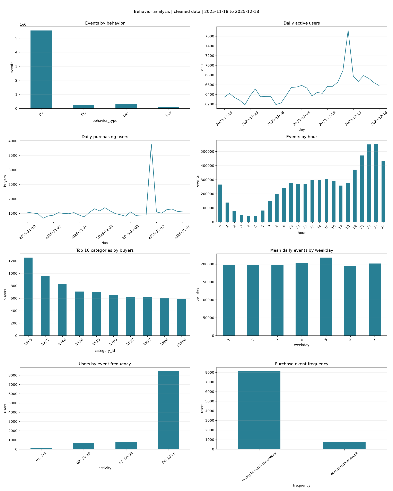

# 抖音商城用户行为分析实习项目

实习于 **2026-11-06** 开始，第一周汇报 **2026-11-13** 提交。本仓库围绕提供的历史样本做可复现分析；不代表平台全量数据或线上实验。

仓库：https://github.com/sshwdh/douyin-user-behavior-analysis 。首周版本：`v0.1.0-week1`。

## 先看这些文件

- [第一周汇报](docs/weekly/2026-11-13_第一周汇报.md)
- [第一周 PDF 周报](output/pdf/2026-11-13_第一周项目汇报.pdf)
- [提前完成的 LR 基线与限制](reports/lr_baseline_report.md)
- [数据分析报告](reports/analysis_report.md)
- [四周每日安排](docs/01_项目执行计划.md)
- [口径与代码解释](docs/02_口径与技术说明.md)
- [特征字典与实现状态](docs/03_特征字典.md)
- [文献阅读](docs/04_文献阅读起点.md)
- [GitHub 发布及助教沟通](docs/05_GitHub提交与助教沟通.md)



## 安装和运行

建议 Python 3.12。所有命令在本仓库根目录执行，CSV 由本人或带教合法提供，默认位于仓库上一级。原始数据不在 Git 中。

```bash
python3 -m venv .venv
.venv/bin/python -m pip install -e '.[dev]'
.venv/bin/python -m douyin_analysis.pipeline --input ../user_behavior.csv
.venv/bin/python -m douyin_analysis.plots
.venv/bin/python -m douyin_analysis.sqlite_store
.venv/bin/python -m douyin_analysis.reporting
```

本次工作环境虚拟环境位于仓库上一级 `.venv`，可替换为 `../.venv/bin/python`，并设置 `PYTHONPATH=src`。`requirements-lock.txt` 在依赖安装成功后生成，记录本次实际版本；复现时优先使用其中版本。

选做预测基线（观察窗固定 2025-11-18 至 12-08 的相应七日窗口）：

```bash
.venv/bin/python -m douyin_analysis.modeling
```

模型脚本存在不代表已经训练，只有实际生成的 `reports/lr_metrics.json` 才是运行证据。完整特征/树模型/深度模型/融合仍按后续计划推进。

本次已生成 LR 指标，见实验报告。十项数值特征已计算，但完整特征清单仍未实现。

## 代码流程

`pipeline`：读取 CSV → 检查字段与有效值 → 四元组全局去重 → Parquet → 聚合 CSV/中间表 → 来源指纹与质量报告。

`plots`：读取聚合结果 → 八张 PNG 和总览图。图例使用英文以避免部署环境缺少中文字体，中文解释在报告中。

`sqlite_store`：每批 10 万行导入 → 构建维表和索引 → 外键与总行数核验；`query_frame` 以参数绑定执行只读 SQL。SQL 示例见 `sql/analysis.sql`。

`modeling`：历史候选对 → 7 日观察/7 日标签 → log1p → 训练集标准化 → 加权 LR → 验证选阈值 → 时间外推测试。

`reporting`：只使用已经生成的质量与聚合结果写报告；未执行的任务明确列为未完成。

## 质量检查

```bash
.venv/bin/black --check src tests
.venv/bin/isort --check-only src tests
.venv/bin/flake8 src tests
.venv/bin/mypy src
.venv/bin/pylint src
.venv/bin/pytest -q
```

`reports/quality_checks.txt` 保存本次实际检查记录。CI 将执行同类检查，但只有仓库上传且工作流运行后才有远端 CI 结果。测试验证去重、非法输入、时间边界和右截尾，不依赖原始数据上传。

完整本地检查：`python scripts/run_checks.py`。已有数据产物时用 `python scripts/validate_outputs.py` 做跨格式校验；原始画像核验需要本次生成的 raw_profile.json。
PDF 可通过安装 `.[reports]` 后执行 `python scripts/build_weekly_pdf.py` 重建。

## 数据与评价限制

用户/商品 ID 保留字符串；时间仅到小时且无时区；行为映射按需求资料解释。没有金额、订单号、曝光或短视频/直播字段，不能输出 GMV、真实 RFM 金额或跨场景归因。四种行为不一定构成依次发生的四步漏斗。

原始样本约 1226 万条、1 万用户。清洗后的确切统计见质量报告。大规模处理方案仅在该实际数据上验证，不声称已经完成亿级压测。

## 仓库管理

`main` 保存可审阅版本，`dev` 汇总开发，`feature/*` 做单项任务。提交遵循 Conventional Commits。原始资料、数据库、用户级中间表、环境及凭证不提交。GitHub 链接与助教发送状态在提供账号/接收渠道后补齐；本地仓库不等于已发布。
