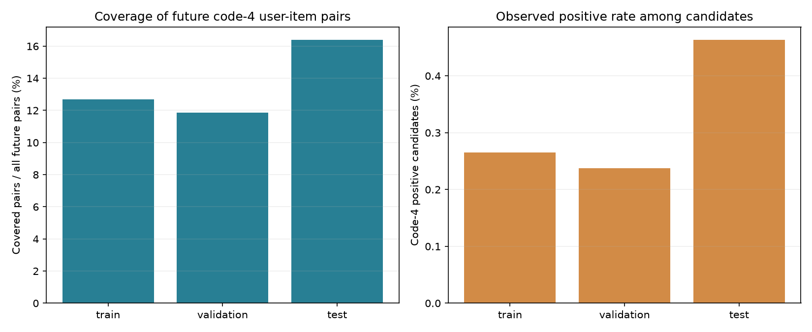
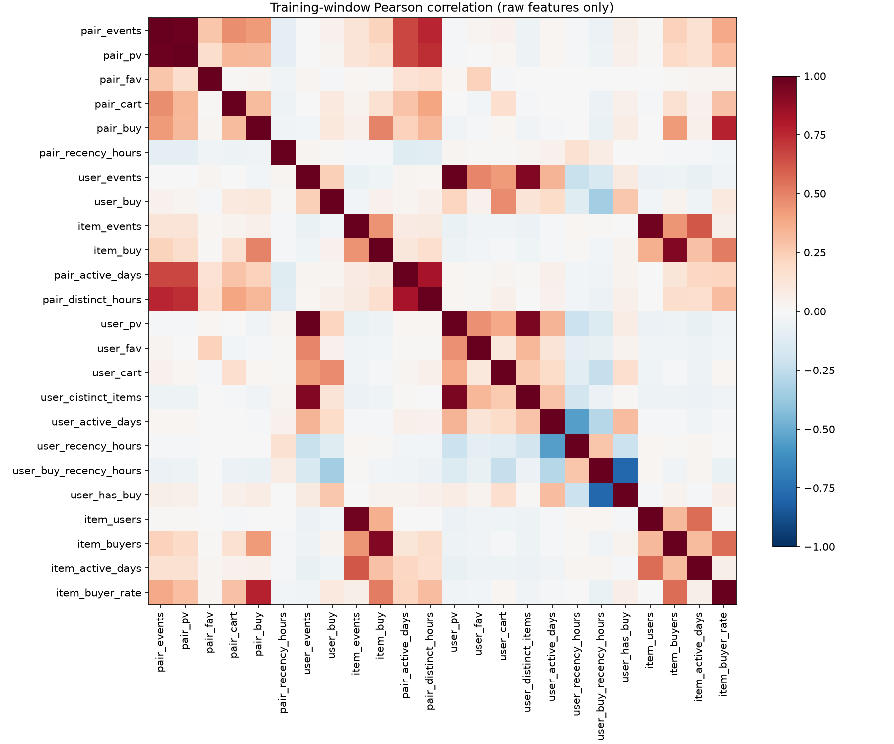

# 窗口特征与样本核验

执行日期：2026-11-17。本轮推进第二周特征与样本准备，不新增模型训练，不改变第一周全量保留口径。

## 来源及可追溯性

输入为全量保留的 12,256,906 条事件。数据快照 `provisional-2cacdd7b8760d553` 中分组已确认，行为码、时区、采样与采集完整性仍待确认。本轮以“行为码 4”为观测标签，技术产物不能证明未发生购买或采集完整。

生成前校验事件 Parquet SHA256，拒绝与审计快照不一致的输入。特征样本仅保存在本地 `data/features/`；公开仓库只保存聚合结果、图表、代码和文件指纹。[产物清单](../reports/features/manifest.json)记录来源、代码指纹、字段顺序和三个样本文件指纹。

## 窗口与候选

| 数据集 | 历史窗：左闭右开 | 标签窗：左闭右开 |
|---|---|---|
| train | 11/18 00:00 至 11/25 00:00 | 11/25 00:00 至 12/02 00:00 |
| validation | 11/25 00:00 至 12/02 00:00 | 12/02 00:00 至 12/09 00:00 |
| test | 12/02 00:00 至 12/09 00:00 | 12/09 00:00 至 12/16 00:00 |

以上日期均为数据中的 2025 年原始时间，不作时区转换。每组观察与标签窗口共有 336 个小时，实际均有记录；若内部缺失任一小时，程序拒绝生成。覆盖每小时不证明小时内全部事件已被采集。

候选为历史七日发生过任意交互的用户商品对，每对一行。标签为未来七日是否观测到行为码 4，同一对多次购买事件只产生一个正标签；这种标签聚合不删除原始交互次数。标签窗结束时刻的记录不属于该窗。

三个标签窗口不重叠；前一窗口标签期会成为下一截点的已知历史，这是按时间滚动的设定。当前允许用户与商品跨窗口重复，不能解读为冷启动测试。

## 实际样本结果

| 数据集 | 候选对 | 正标签对 | 正例率 | 未来全部行为码 4 对 | 候选覆盖率 |
|---|---:|---:|---:|---:|---:|
| train | 1,030,893 | 2,735 | 0.2653% | 21,556 | 12.69% |
| validation | 1,061,515 | 2,525 | 0.2379% | 21,268 | 11.87% |
| test | 1,117,324 | 5,175 | 0.4632% | 31,583 | 16.39% |

覆盖率 = 未来行为码 4 对中已出现在历史候选的对数 / 未来全部行为码 4 对数。测试窗另有 26,408 对未进入候选，当前模型即使把候选中的正例全部找出，也只能覆盖全部未来购买对的 16.39%。这是候选范围上限，**不是已经实现的模型召回率**。

正例率低，后续须保留验证与测试的自然分布；报告 AP、Precision、Recall 等指标及候选覆盖，不以 Accuracy 单独判断效果。现有三个窗口的正例率不同，不能仅据此断言发生了业务机制变化。



## 特征质量与冗余

已实现并运行 24 项特征，详见[特征字典](03_特征字典.md)。三个窗口均无缺失、非有限值、负值、候选键重复或常量列。未使用全观察期的用户/商品汇总作为特征。

训练原值 Pearson 相关较高的例子：user_events 与 user_pv 约 0.9979；pair_events 与 pair_pv 约 0.9786；item_events 与 item_users 约 0.9655。总事件数又等于四类事件数之和，存在结构性冗余。后续采用训练/验证集消融和正则化评估，不能据当前相关性图声称新特征提高效果。



完整分布见[特征质量表](../reports/features/feature_quality.csv)，窗口计数见[样本汇总](../reports/features/sample_summary.csv)。样本仍保持自然类别比例，没有做过采样或欠采样。

## 验证证据

- 手工构造重复事件，核对重复次数、活跃时间桶、最近交互、独立买家比例及标签边界。
- 向未来窗口增加购买与新用户商品对，确认只改变标签，历史特征及候选集合不变。
- 检查内部缺失小时、非整小时截点及陈旧数据指纹均被拒绝。
- 用独立候选与未来购买对查询核对三个窗口正标签数量。
- 完整规范检查与 26 项测试通过，日志见[质量检查](../reports/quality_checks.txt)。这些测试覆盖上述已实现逻辑，不代表所有业务假设已获确认。

## 复现及下一步

在已安装依赖的仓库环境执行：

```bash
python -m douyin_analysis.feature_audit --snapshot reports/audits/2026-11-17/data_snapshot.json
python scripts/run_checks.py
```

下一步在同一批样本上比较原 10 项与新增 24 项特征的 LR，验证集定阈值，测试集只用于固定方案评价；所有语义假设必须保留在实验说明中。树模型及后续阶段尚未开展，本轮也未更新旧 LR 指标。
