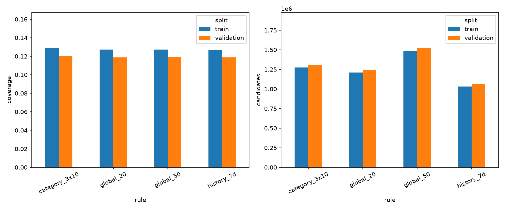

# 树模型准备与候选覆盖核验

日期：2026-11-17。快照：provisional-2cacdd7b8760d553。

## 本次范围

树模型仅完成固定配置、开发样本指纹核对和合成数据运行测试，未拟合真实数据。候选诊断只评价训练、验证窗口；不读取测试样本、不评价测试窗口。行为码 4 暂作目标事件，业务含义、采样完整性和业务时区仍待确认。

## 候选定义与防泄漏

每个窗口使用截止日前 7 天历史事件，目标为随后 7 天出现的唯一代码 4 用户商品对；重复事件保留，目标对去重只用于二元标签计数。当前候选是历史交互用户商品对。

固定扩展规则为：保留当前候选，再分别添加历史活跃用户与全局前 20 / 50 热门商品的组合，或用户偏好前 3 类目中各前 10 热门商品。商品按历史独立交互用户数排序，同分按商品 ID；偏好类目按历史独立交互商品数排序，同分按类目 ID。所有规则只使用历史信息，没有用未来购买商品构造候选。参数为本次预设诊断方案，并未进行搜索优化。

## 验证窗口结果

历史：2025-11-25 至 2025-12-02（右端不含）；目标：2025-12-02 至 2025-12-09（右端不含）。未来目标共 21,268 对。

| 规则 | 候选数 | 覆盖目标对 | 覆盖率 | 新增候选 | 新增覆盖 |
|---|---:|---:|---:|---:|---:|
| 历史交互 | 1,061,515 | 2,525 | 11.8723% | 0 | 0 |
| 全局热门 20 | 1,244,449 | 2,527 | 11.8817% | 182,934 | 2 |
| 全局热门 50 | 1,520,024 | 2,539 | 11.9381% | 458,509 | 14 |
| 偏好类目 3×10 | 1,307,535 | 2,551 | 11.9945% | 246,020 | 26 |

类目扩展增加约 23.18% 候选，覆盖率仅增加约 0.1222 个百分点；新增候选中命中目标的比例约 0.0106%。这几种简单热门规则增益有限，不足以据此替换现有候选。训练窗口结果方向一致，详见汇总 CSV。



## 覆盖不足的来源

验证窗口中，已覆盖 2,525 对；历史中用户、商品都出现但组合未出现的有 5,407 对；用户出现而商品未出现的有 12,840 对；用户未出现而商品出现的有 185 对；二者均未出现的有 311 对。这五组互斥且合计 21,268。

其中 12,840 对（约 60.37%）属于“历史有该用户、但没有该商品”。此处“未出现”仅指当前 7 天历史窗口，不能称为平台新商品或判定数据遗漏。仅依赖当前窗口商品热度无法召回这部分商品；延长历史、外部商品池是否可用，需要结合任务定义及数据字典判断。

## 树模型对照协议

准备两种 HistGradientBoostingClassifier，叶节点上限分别为 15 / 31；迭代 150 次、学习率 0.05、叶节点最少 50 样本、L2=1、类别权重 balanced、随机种子 42。关闭内部随机早停验证，以维持时间划分。直接使用原有 24 项数值特征，不缩放、不重采样。

后续仅按验证集 average precision 选择模型，同分选较小树；阈值按验证 F1 最大值选择，同分选更高阈值。对照为相同候选集合的 LR-24 验证 AP 0.02782960959。类别加权分数不应直接解释为校准购买概率。此次没有真实树模型效果、没有扩展候选的模型特征和模型效果。

现有测试集已用于 LR 评价，不再用于本轮调参或候选规则选择；后续若需独立最终效果，应另留未使用数据。仅有开发窗口结果时须明确其开发性质。

## 复现与交付

在项目根目录配置 Python 环境后执行：

```bash
PYTHONPATH=src python -m douyin_analysis.candidate_audit
PYTHONPATH=src python -m douyin_analysis.tree_preparation
python scripts/run_checks.py
```

公开产物：`reports/candidates/coverage.csv`、`strata.csv`、`manifest.json`、覆盖图和 `reports/trees/preparation.json`。用户商品级候选和原始记录不上传公开仓库。

下一步优先确认行为定义及任务是否要求覆盖未交互商品；随后在当前候选上运行固定树模型验证对照。扩大候选需要补充“无用户商品交互”的特征定义，不能直接复用仅覆盖历史交互对的样本生成逻辑。
