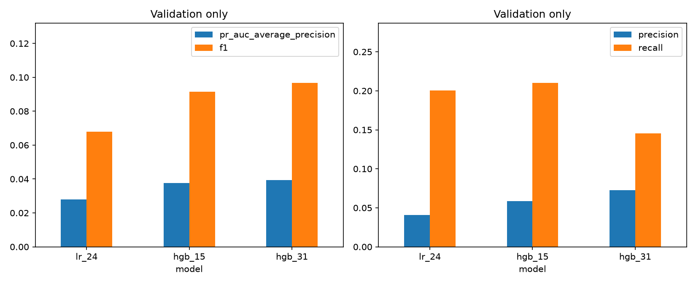
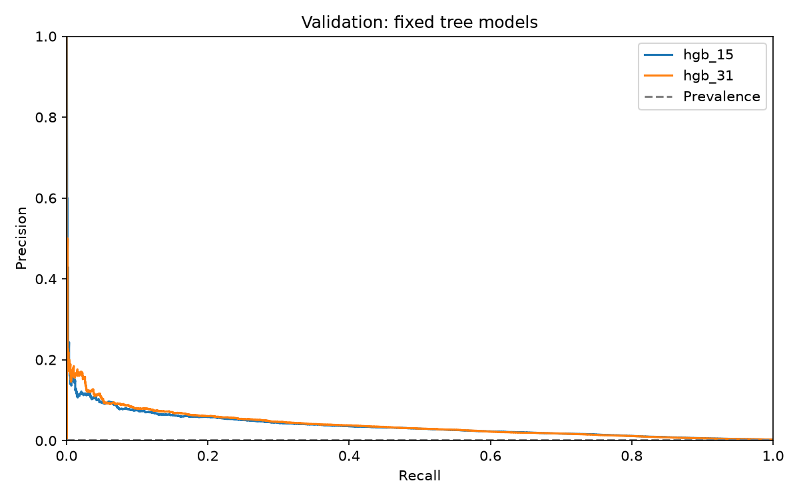

# 固定树模型验证集对照

日期：2026-11-17。两组模型真实训练已完成；本轮只评价验证集，未访问测试样本。

## 固定协议与数据

沿用准备阶段参数：15 / 31 叶节点上限、150 次迭代、学习率 0.05、叶节点最少 50 样本、L2=1、类别权重 balanced、随机种子 42，关闭内部早停。使用现有历史交互候选和 24 项特征；树使用原始数值，LR 使用其已固定变换。没有扩展候选、搜索参数或重采样。

训练样本 1,030,893 行，验证样本 1,061,515 行（正例 2,525）。已核对两者指纹与 LR 实验一致。训练历史为 2025-11-18 至 11-25，标签为 11-25 至 12-02；验证历史为 11-25 至 12-02，标签为 12-02 至 12-09，全部左闭右开。

## 验证结果

| 模型 | AP | ROC-AUC | 精确率 | 召回率 | F1 | 阈值 |
|---|---:|---:|---:|---:|---:|---:|
| LR-24 | 0.027830 | 0.883743 | 4.08% | 20.04% | 0.067806 | 0.948675 |
| HGB-15 | 0.037586 | 0.885047 | 5.84% | 21.03% | 0.091410 | 0.925784 |
| HGB-31 | 0.039328 | 0.881827 | 7.25% | 14.53% | 0.096770 | 0.937109 |

按预定的验证 AP 选择 HGB-31，相比 LR-24 相对提高约 41.32%。这只是单一验证窗口的观察结果，未经独立测试或显著性检验，不能表述为稳定或线上收益。

在各自验证 F1 最优阈值下，HGB-31 精确率提高，但召回率下降，ROC-AUC 也略低于 LR。不能称所有指标改善。HGB-15 的召回率较高，但 AP 低于 HGB-31；依原协议保留 HGB-31 为开发阶段候选。

HGB-31 预测正例 5,060 对：正确 367、误报 4,693、漏报 2,158。表中召回率分母仅为候选内 2,525 个目标；相对全部未来 21,268 个目标对，命中比例约 1.73%。候选覆盖率仍为 11.87%，模型提升不能弥补候选缺失。

## 解释边界和下一步

阈值按同一验证集最大 F1 选择，因此阈值相关指标存在选择乐观性。AP 指 average precision，不是梯形积分 PR 面积。类别加权输出未经概率校准；行为码 4、业务时区、采样完整性仍待确认，暂称目标事件，不解释为交易金额或商业收益。

两组固定模型各训练一次；本轮未使用测试集选择模型、阈值或参数。旧测试集已用于 LR，独立最终评价需另留未使用数据。建议冻结本次开发候选，下一步检查验证集误报、漏报的分布，并结合带教对任务范围的确认决定是否扩展商品池。

## 复现与交付

项目根目录执行 `PYTHONPATH=src python -m douyin_analysis.tree_experiment`。训练前校验固定配置、特征及数据指纹。公开目录 `reports/experiments/tree_validation_2026-11-17/` 保存执行配置、指标、汇总表和图。比较表中的 LR 行来自已存档 LR 验证结果。模型保存在本地 `data/models/tree_validation_2026-11-17/`，不上传公开仓库。

编码规范检查及 33 项测试通过。准备阶段报告保留当时状态，本报告记录后续真实训练完成状态。
