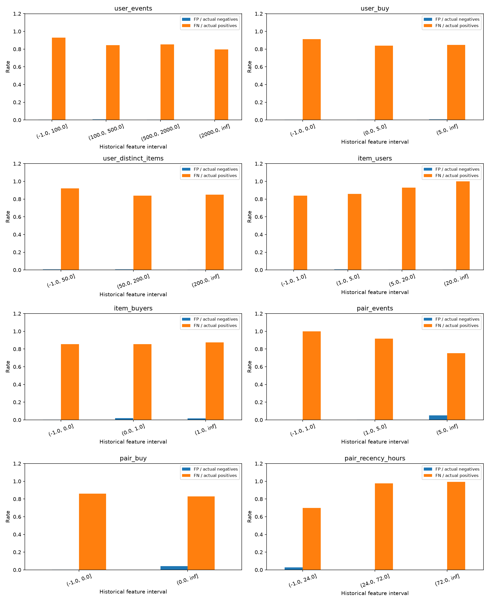

# 固定树模型验证集误报、漏报分析

日期：2026-11-17。模型 HGB-31，阈值 0.9371093235066793。未重训、未调整阈值、未使用测试集。

## 方法和核验

只读取固定模型和已审计的验证样本，重算预测后逐项核对存档指标。复现结果：1,061,515 个候选对，2,525 个目标正例；TP=367、FP=4,693、FN=2,158、TN=1,054,297。漏报率为 85.47%，误报率为 0.4432%，精确率 7.25%。类别极不均衡，因此低误报率不等于预测正例可靠。

分组全部使用截点前 7 天历史特征，按预先写入代码的固定区间统计，没有依据标签搜索最优分箱。每个分组维度的 TP、FP、FN、TN 均与总数守恒。表中样本是用户商品对，不是独立用户数；不同维度会重复描述同一个错误，不能跨维度加总。

误报率=FP/真实负例；漏报率=FN/真实正例；错误占比=该组错误数/全部同类错误数。零分母留空，不当作 0。汇总表标记正例不足 30 的组；这只是描述性提示，不是统计显著性的保证。行为码 4 暂作目标事件，业务含义、时区与采样完整性仍待确认。

## 1. 最近交互时间：误报集中在近期，较早交互目标大量漏掉

| 最后交互距截点 | 候选对 | 真实正例 | 误报 FP | 占全部误报 | 漏报 FN | 漏报率 |
|---|---:|---:|---:|---:|---:|---:|
| ≤24 小时 | 170,826 | 1,149 | 4,503 | 95.95% | 802 | 69.80% |
| >24 且 ≤72 小时 | 318,544 | 706 | 167 | 3.56% | 690 | 97.73% |
| >72 小时 | 572,145 | 670 | 23 | 0.49% | 666 | 99.40% |

近期组仅占约 16.09% 候选，却贡献 95.95% 误报；其误报率 2.65%，高于整体。超过 24 小时的两组共有 1,376 个正例，仅识别出 20 个，漏报 1,356 个，占全部漏报约 62.84%。当前预测正例高度集中在近期交互对；这不能单凭分组分析证明“时间特征导致错误”。

## 2. 交互次数：高频组误报较多，但不是错误数据

| 同一用户商品对历史交互次数 | 候选对 | 真实正例 | 误报 FP | 误报率 | 漏报 FN | 漏报率 |
|---|---:|---:|---:|---:|---:|---:|
| 1 次 | 302,036 | 128 | 8 | 0.0026% | 128 | 100.00% |
| 2—5 次 | 704,565 | 1,378 | 1,912 | 0.2719% | 1,263 | 91.65% |
| >5 次 | 54,914 | 1,019 | 2,773 | 5.1452% | 767 | 75.27% |

>5 次组只占约 5.17% 候选，却贡献 59.09% 误报；同时其目标发生率为 1.86%，高于整体 0.238%。它既包含更多正例，也包含较多被预测为正的负例，不能据此删除高频行为。此处统计的是 7 天内用户商品对全部行为次数，与带教确认的“用户＋商品＋行为＋小时，>100 次”异常核查口径不同。

## 3. 用户特征：低活跃和无历史目标行为的召回较弱

- 历史总行为 ≤100 次的用户对应 244 个正例，漏报 227 个，漏报率 93.03%。
- 历史目标行为为 0 的用户对应 447 个正例，漏报 408 个，漏报率 91.28%。
- 历史交互商品数 ≤50 的用户对应 330 个正例，漏报 304 个，漏报率 92.12%。
- 历史总行为 101—500 次组贡献 47.92% 误报、45.51% 漏报，但也有 423,662 个候选。应结合分母解释，不能只按错误总量认定这一群体最差。

上述群体重叠，不能将它们的漏报数相加。对活跃用户的样本权重由候选对数量决定，不等于用户层面公平比较。

## 4. 商品特征：多数错误来自长尾，热门组也存在召回缺口

- 历史仅 1 名交互用户的商品对应 697,735 个候选（约 65.73%），贡献 64.42% 误报和 63.39% 漏报。错误占比与样本占比接近，不能认定长尾商品整体更差。
- 历史交互用户 >20 的商品有 44 个正例，全部漏报；该组仅占全部漏报约 2.04%，正例数量有限，需后续窗口验证，不能据此概括所有热门商品。
- 无历史目标用户的商品有 1,011,994 个候选，漏报 1,740 个；该组样本基数非常大。历史目标用户为 1 的商品误报率约 2.01%，高于无历史目标用户商品的约 0.37%，但各组基础目标发生率不同，不能当作因果关系。

## 改进优先级：先验证假设，再改动模型

1. 优先检查“较早交互”和“低频交互”目标的分数分布，并与 LR 对同一批样本的识别结果对照，以判断是固定阈值取舍还是排序本身不足。若探索不同阈值，应另记开发实验，不能覆盖本次冻结结果。
2. 设计历史窗口内的近期/较早交互计数、行为类型组合等特征对照，观察能否区分近期高频但无后续目标的候选。现有模型已有总次数、活跃天数和最近交互时间，新特征须提供不同信息。只有后续受控实验才能检验收益，不提前承诺。
3. 将候选内漏报与候选外遗漏分开：本报告 FN=2,158 仅是候选内；另外 18,743 个未来目标对根本不在候选中。更换分类器不能修复候选外遗漏，是否扩展商品池仍依赖任务边界和数据来源确认。

本次为选型后同一验证集上的描述性诊断，既不是独立性能验证，也不是因果归因。后续据此优化会进一步使用验证信息，需要新保留数据才能给出独立最终评价。

## 复现和交付

运行 `PYTHONPATH=src python -m douyin_analysis.error_analysis`。输出在 `reports/errors/tree_validation_2026-11-17/`：分组汇总 CSV、结果图和记录模型/样本/指标/代码指纹的清单。无用户 ID、商品 ID 或逐条预测上传公开仓库。代码规范检查与 35 项测试通过，测试覆盖分组计数守恒、区间和阈值边界、零分母及非法分数处理。
