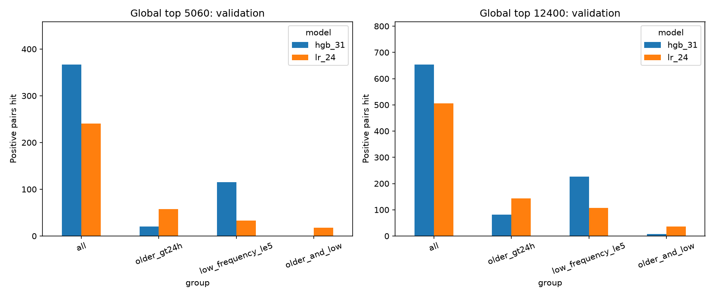

# LR 与树模型的较早、低频交互目标对照

日期：2026-11-18。对照 LR-24 与 HGB-31，使用同一验证样本；未重训、未修改原阈值、未访问测试集。

## 方法

验证样本 1,061,515 对、目标正例 2,525 对。两模型复现的全部验证指标均与各自存档一致；模型、样本、指标文件和诊断代码指纹见结果清单。

较早交互定义为最后交互距截点 >24 小时；低频定义为历史 7 天内同一用户商品对交互 ≤5 次；另看单次交互和较早且低频交集。分组可能重叠，不能跨组累加。

除原阈值外，固定全局 Top-5,060 和 Top-12,400 两种诊断预算。这两个数量来自此前两模型各自固定阈值的预测数量，并非本轮搜索最优预算。每个模型在全体验证候选中取前 K 名，再统计各组命中；不是每组各选 K 名。同分按既有验证行序（用户、商品排序）稳定截断。Top-K 是诊断方案，不替换原阈值，也不是线上实施建议。

## 总体：等预测数量下，树模型命中更多

| 预测规则 | LR 预测数 | LR 命中数 | 树预测数 | 树命中数 |
|---|---:|---:|---:|---:|
| 各自固定阈值 | 12,400 | 506 | 5,060 | 367 |
| 全局 Top-5,060 | 5,060 | 241 | 5,060 | 367 |
| 全局 Top-12,400 | 12,400 | 506 | 12,400 | 654 |

Top-12,400 下树模型精确率为 5.27%、召回率 25.90%；LR 为 4.08%、20.04%。树模型原固定阈值下的较低总体召回，包含预测数量更少的取舍，不能等同于总体排序更差。

扩大树模型预测数也有成本：从 5,060 到 12,400 多识别 287 个正例，同时增加 7,053 个误报；精确率由 7.25% 降为 5.27%。没有业务收益、误报成本和处理容量，不能直接决定上线阈值。

## 分组：总体提升并未解决较早交互目标的覆盖

以下表内数量为命中正例数；括号为该组正例总数。

| 分组 | LR 固定 | 树固定 | LR Top-5,060 | 树 Top-5,060 | LR Top-12,400 | 树 Top-12,400 |
|---|---:|---:|---:|---:|---:|---:|
| 较早交互（1,376） | 143 | 20 | 58 | 20 | 143 | 81 |
| 低频交互（1,506） | 107 | 115 | 33 | 115 | 107 | 227 |
| 单次交互（128） | 0 | 0 | 0 | 0 | 0 | 2 |
| 较早且低频（896） | 36 | 0 | 18 | 0 | 36 | 8 |

树模型对低频组整体优于 LR，但单次交互目标仍几乎没有命中。不能把所有低频候选一概认定为树模型弱项。

对较早交互，树模型 Top-12,400 只分配了 1,738 个预测名额，LR 分配 5,511 个。树的该组精确率反而较高（4.66% 对 2.59%），但召回更低（5.89% 对 10.39%）。较早组内部 AP 也是树较高（0.019685 对 0.013953）。因此现有证据更支持继续检查跨组分数排序和预测名额分配，而非断言树模型在该组内部排序更差。

## 分数：重点看各模型内部位置，不能直接比较概率

下表仅统计真实正例分数的 P10 / 中位数 / P90；各组所有候选参与上面的 AP 和预测排名。

| 目标分组 | LR P10 / 中位数 / P90 | 树 P10 / 中位数 / P90 |
|---|---|---|
| 较早交互 | 0.2087 / 0.6983 / 0.9495 | 0.1293 / 0.6880 / 0.8872 |
| 低频交互 | 0.2134 / 0.6563 / 0.9337 | 0.1282 / 0.6324 / 0.9287 |
| 单次交互 | 0.0813 / 0.2085 / 0.8580 | 0.0620 / 0.1899 / 0.6164 |
| 较早且低频 | 0.1642 / 0.5132 / 0.8815 | 0.1034 / 0.4686 / 0.8412 |

原阈值为 LR 0.948675、树 0.937109。树的较早交互正例 P90 仍低于其原阈值，符合该组命中少的现象。两模型均使用类别权重且未经概率校准，数值不是可直接互比的购买概率；不能将跨模型分数大小作为优劣证据。

## 命中互补：可以形成假设，尚不足以推荐融合

Top-12,400 的较早组中，两模型共同命中 50 个、仅 LR 命中 93 个、仅树命中 31 个、均未命中 1,202 个。总体共同命中 346 个、仅 LR 命中 160 个、仅树命中 308 个。两者存在互补，但合并预测集合会增加预测数和误报；未做同预算融合验证，不能直接宣布融合有效。

## 改进判断与下一步

1. **预测取舍方面**：总体可以通过扩大预测预算换取召回，但需承担额外误报；在没有业务成本信息时保留原阈值，不把诊断预算当作正式策略。
2. **特征方面**：优先针对“较早且低频”和单次交互，设计一个小规模、固定参数的特征对照，例如近期/较早行为计数、行为类型组合与用户活跃程度的交互信息。现有结果只是提出假设，不证明这些新特征一定有效。
3. **比较方式**：后续同时报告总体 AP、等预算命中、较早/单次交互分组命中。分组阈值或模型融合若要探索，应作为独立开发实验预先定义，不能事后挑选最好结果。

全部结果来自已用于选型的同一验证窗口，存在选择偏差和重复使用验证信息的问题，没有独立测试或显著性结论。行为码 4 暂作目标事件，业务含义、采样完整性和时区仍待确认。候选外遗漏不在本次比较范围内，改进分类器不代表解决候选覆盖问题。

## 交付与复现

运行 `PYTHONPATH=src python -m douyin_analysis.error_comparison`。结果位于 `reports/errors/lr_tree_comparison_2026-11-18/`，包含分组指标与分数分位数、命中交集、图表、固定诊断协议及模型指纹。公开结果不含用户商品标识或逐条预测。

质量核验：编码规范检查及 37 项测试通过；新增测试覆盖同分稳定排序、预算边界、分组不得重新分配预算及命中交集计数。
