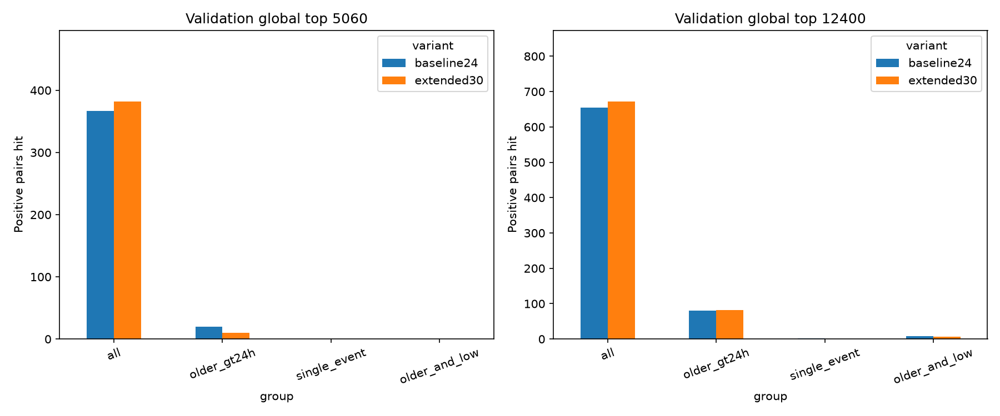

# 六项历史特征的小规模对照

日期：2026-11-18。本轮仅完成特征开发实验。带教尚未确认行为含义、采样完整性与候选范围，未扩大候选、未确定业务阈值、未形成最终业务结论。

## 结论

新增六项特征后，验证总体 AP 从 0.039328 提升至 0.043185（相对约 +9.81%），但预期改善的“较早且低频”和“单次交互”目标没有改善。保留原 HGB-31 基线，新模型作为开发实验留档，不宣称解决漏报问题或获得业务收益。

## 实验设计与特征说明

原模型 24 项特征，新模型 30 项。两者使用相同训练/验证窗口、候选、标签与 HGB-31 参数：150 次迭代、31 叶节点上限、学习率 0.05、叶节点最少 50 样本、L2=1、balanced 类别权重、随机种子 42、关闭内部早停。新模型只训练一次，不搜索参数；旧模型直接读取，并复现所有存档验证指标。

新增特征只使用截点前 7 天事件，不需要先认定行为码的业务名称：

| 新增特征 | 定义 |
|---|---|
| pair_events_last24h | [截点−24h, 截点) 内该用户商品对交互次数 |
| pair_events_24to72h | [截点−72h, 截点−24h) 内交互次数 |
| pair_behavior_types | 7 天历史出现的行为码种类数 |
| pair_span_hours | 7 天历史最早至最后一次交互间隔小时数 |
| pair_user_event_share | 该对交互次数 / 用户历史总交互次数 |
| pair_item_event_share | 该对交互次数 / 商品历史总交互次数 |

分母在原候选集合内均大于 0。按键一对一合并，核对原候选顺序、全部原特征和标签保持不变；新增特征无缺失、无非有限值。训练候选 1,030,893 对，验证 1,061,515 对，验证正例 2,525 对。时间边界测试包含恰好 24、72、168 小时和截点当时的事件，验证重复记录保留、未来记录不影响特征。

这是“整组六项新增特征”的对照，不能据此判断某一项特征单独贡献了多少。

## 总体结果

| 指标 | 原 24 项 | 新 30 项 |
|---|---:|---:|
| AP（average precision） | 0.039328 | 0.043185 |
| ROC-AUC | 0.881827 | 0.884565 |
| 验证 F1 最优阈值 | 0.937109 | 0.940035 |
| 精确率 | 7.25% | 7.99% |
| 召回率 | 14.53% | 14.50% |
| F1 | 0.096770 | 0.102997 |
| 预测正例 | 5,060 | 4,582 |
| 命中正例 | 367 | 366 |
| 误报 | 4,693 | 4,216 |

新方案按同一验证集最大 F1 选择开发阈值，同分选更高阈值；没有覆盖旧模型阈值。上表阈值指标有同集选择乐观性，且两个模型预测数量不同，因此还需等预算比较。该阈值不是业务决策阈值，类别加权分数也不是校准后的购买概率。

## 等预算命中：薄弱分组未改善

预算为之前已经固定的全局 Top-5,060 和 Top-12,400；先在全部候选中排序，再统计各组命中，不对各组重新分配预算。较早指 >24 小时，低频指历史 7 天交互 ≤5 次。

| 分组 | 原 Top-5,060 | 新 Top-5,060 | 原 Top-12,400 | 新 Top-12,400 |
|---|---:|---:|---:|---:|
| 全部（2,525 正例） | 367 | 382 | 654 | 672 |
| 较早交互（1,376） | 20 | 10 | 81 | 82 |
| 低频交互（1,506） | 115 | 113 | 227 | 226 |
| 单次交互（128） | 0 | 0 | 2 | 0 |
| 较早且低频（896） | 0 | 0 | 8 | 6 |

总体等预算命中增加，但收益主要体现在近期或高频组；组之间有重叠，不能把各组增益相加。小预算下较早组命中从 20 降到 10；大预算下仅增加 1 个。单次交互组在大预算下由 2 降为 0。因此不能仅凭总体 AP 上升就采用新方案。

## 后续安排与待确认事项

暂不扩大参数搜索，也不立刻叠加更多特征。建议先整理本阶段周报，将成功与未达预期的实验完整记录；后续如继续开发，应预先定义一个针对较早交互的受控方案及组内最低召回目标，并保留总体误报成本约束。是否采用分组策略、融合或新增特征需另做对照，当前结果不支持直接采用。

扩大候选范围需确认是否要求未交互商品及可用商品池；确定业务阈值需确认目标行为、负例可靠性、处理容量及误报/漏报成本；最终业务结论需要这些口径确认和未参与开发的数据独立检验。当前验证集已多轮使用，所有结果仅作为开发证据，没有显著性或线上收益结论。

## 交付与复现

运行 `PYTHONPATH=src python -m douyin_analysis.feature_ablation`。实验协议在拟合前保存，代码和数据指纹见 `reports/experiments/temporal_features_2026-11-18/protocol.json`；指标、等预算汇总、特征质量表和结果图位于同目录。本地模型位于 `data/models/temporal_features_2026-11-18/extended30.joblib`，不上传公开仓库。原始数据、原特征样本及测试样本未修改；本轮未访问测试样本。

质量核验：编码规范检查和 38 项测试全部通过。
