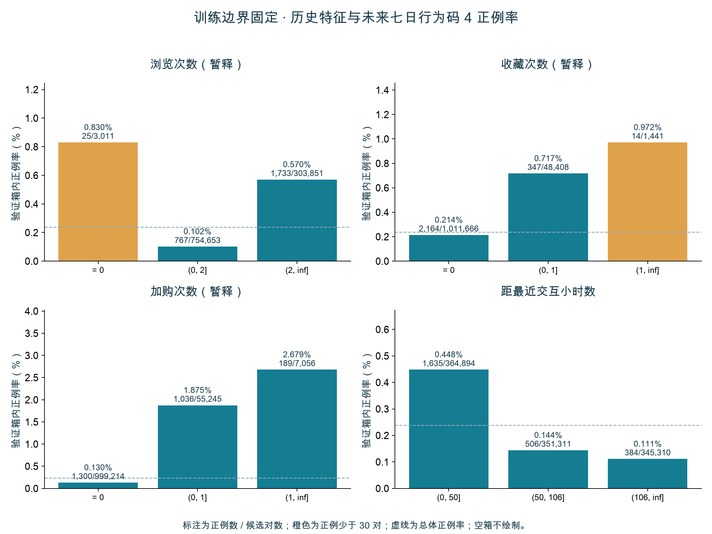
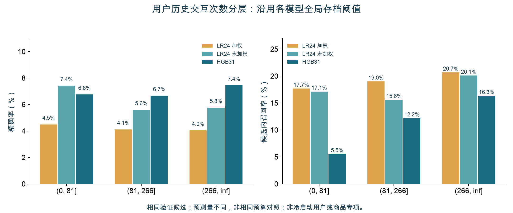
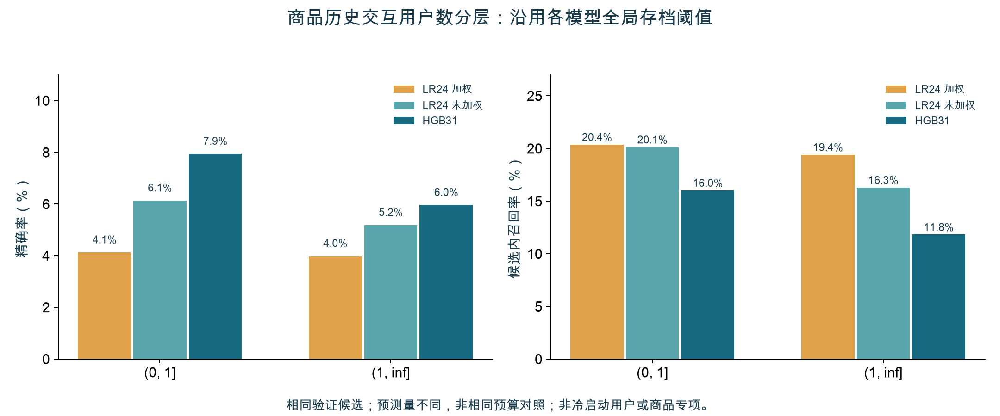

# 特征关联与用户商品分层

日期：2026-11-25。补充大纲中的特征分箱目标关联、用户及商品分层表现；仅为现有验证窗口的描述分析。

## 实验口径与复现

- 训练历史窗：2025-11-18 至 11-25；验证历史窗：11-25 至 12-02；验证标签窗：12-02 至 12-09，均左闭右开、原始时间、不转换时区。
- 候选为历史七日有交互的用户商品对。验证候选 1,061,515 对、正例 2,525 对，正例率 0.2379%；标签为未来七日观察到行为码 4。
- 先记录协议，再读取训练样本决定边界，保存边界后才读取验证样本。零值独立成箱，正值采用训练三分位（higher 方法），重复分位合并；区间左开右闭，末箱无上限，覆盖验证超出训练最大值的情况。
- 用户活跃度边界由训练集去重用户决定；商品热度边界由训练集去重商品决定。其他边界由训练候选对决定。所有展示指标仍按验证候选对计算，不是用户平均指标。
- 不使用验证标签搜索边界，不访问测试样本，不重训模型，不修改阈值。三种模型的全局验证指标全部复现存档后，才输出分层结果。
- 零分母比率留空；空箱、单类别箱的 AP/AUC 留空。正例或预测正例少于 30 对作为阅读提示，不是统计显著性判定。未将相关候选当作独立样本计算置信区间。

```bash
python -m douyin_analysis.segment_analysis
```

源码：[分箱与统计](../src/douyin_analysis/segment_analysis.py)、[看板展示](../src/douyin_analysis/dashboard_segments.py)。需要本地训练/验证样本及已有模型；公开看板只读取匿名汇总，不执行训练。

## 训练边界

| 历史特征 | 固定区间 |
|---|---|
| 浏览次数（暂释） | 0；(0, 2]；(2, +∞) |
| 收藏、加购次数（暂释） | 0；(0, 1]；(1, +∞) |
| 距最近交互小时数 | 0；(0, 50]；(50, 106]；(106, +∞) |
| 用户历史交互次数 | 0；(0, 81]；(81, 266]；(266, +∞) |
| 商品历史交互用户数 | 0；(0, 1]；(1, +∞) |

商品数据中相同分位值合并后只形成两个有样本的区间，不强行称为“爆款／腰部／长尾”三档。部分零值箱在验证集为空，保留用于可追溯，图中不把空箱画成正例率为零。

## 特征关联结果

| 历史加购次数（暂释） | 候选对 | 正例对 | 正例率 |
|---|---:|---:|---:|
| 0 | 999,214 | 1,300 | 0.1301% |
| 1 | 55,245 | 1,036 | 1.8753% |
| 大于 1 | 7,056 | 189 | 2.6786% |

最近交互不超过 50 小时的正例率为 0.4481%，超过 106 小时为 0.1112%。这些是同一候选策略下的关联，不是因果作用，也不证明增加某项特征会改善模型。

浏览为零组仅 25 个正例；收藏大于一次组仅 14 个正例，已标记低支持。浏览为零不代表用户从未看过商品，只表示本历史窗未观察到相应行为码。



## 用户分层：当前取舍在哪些群体上更明显

用户历史交互不超过 81 次的组有 47,103 个候选对、181 个正例：

| 模型 | 预测正例 | 命中 | 精确率 | 候选内召回率 |
|---|---:|---:|---:|---:|
| LR24 加权 | 712 | 32 | 4.49% | 17.68% |
| LR24 未加权 | 418 | 31 | 7.42% | 17.13% |
| HGB31 | 148 | 10 | 6.76% | 5.52% |

该组 HGB31 的阈值下预测量更少、召回更低；不能仅据此断言算法一定较差。箱内 AP 分别约 0.03017、0.04116、0.03043，亦仅作为该窗口的探索证据。



## 商品分层

历史仅有 1 名交互用户的商品对应 697,735 个验证候选、1,629 个正例；超过 1 名交互用户的商品对应 363,780 个候选、896 个正例。

HGB31 在两组的精确率分别为 7.95%、5.97%，召回分别为 16.02%、11.83%。相同模型的分组差异也可能受群体构成和特征分布影响，不能直接当作商品运营建议。



## 看板入口与解释限制

- 用户行为页底部展开“特征与目标 · 分箱正例率”，可选择六项历史特征，查看验证样本量、正例率和计数表，下载当前分箱 CSV。
- 模型页底部展开“用户与商品分层 · 三模型表现”，切换用户或商品维度，以及精确率、召回率、命中、AP、AUC；下载当前三模型汇总。
- 两个模块固定验证窗口，不随行为页任意日期重算；分层模块独立比较三模型，不随页首模型选择变化。
- 各模型沿用不同的存档全局阈值，不是相同预测预算比较，不进行组内阈值优化。各组 AP 与组内正例率有关，不应孤立跨组比较 AP。
- 同一用户会贡献多个候选；不同维度及模型重复覆盖同一批样本，不能跨维度或模型相加当作独立用户量。
- 真正无历史交互的对象不在候选中，本次不是冷启动专项分析，也不是业务阈值或最终收益结论。

结果与来源指纹：[汇总目录](../reports/dashboard/segments/)、[协议](../reports/dashboard/segments/protocol.json)、[输出清单](../reports/dashboard/segments/manifest.json)。
