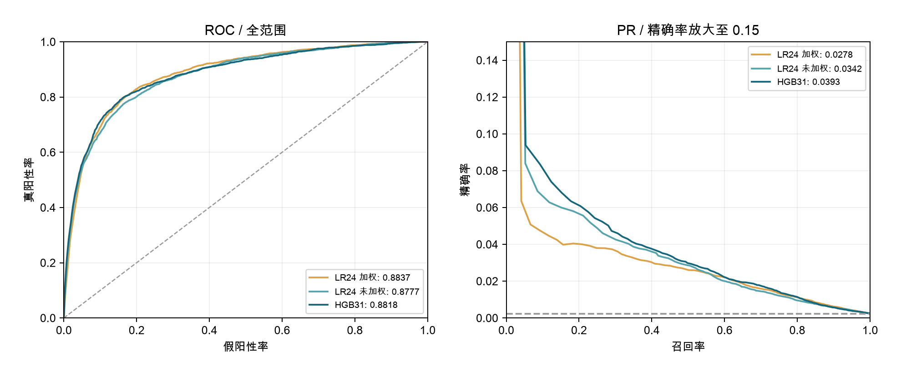
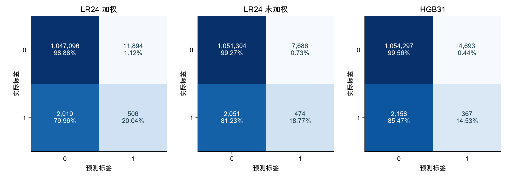
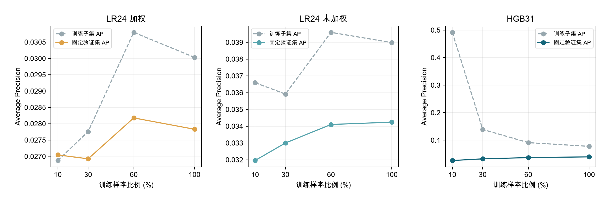
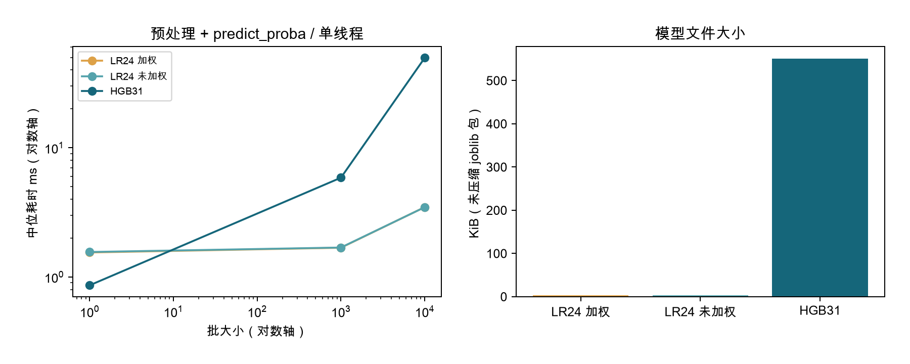

# 模型评估补充报告

## 模型评估补充报告

抖音商城用户行为分析 / 2026-11-27

任务：在过去七日发生过交互的用户商品对中，预测未来七日是否观测到行为码 4。二分类；一对一行。行为码 4 暂作购买目标，尚未确认采样完整性，负标签只表示窗口内未观测到目标。

| 模板要求 | 本次处理 |
| --- | --- |
| 基础信息、数据划分、标签分布 | 统一汇总既有数据口径与模型配置。 |
| ROC／PR、模型与版本比较 | 复用存档曲线和全量指标，不以抽点曲线重新积分。 |
| 学习曲线、偏差与方差讨论 | 新增三模型、四档训练规模诊断；不调参、不替换基线。 |
| 误差分组、具体案例 | 复用分组研究；新增 12 条匿名极端误报／漏报案例。 |
| 推理速度、文件大小、资源 | 新增独立进程、单线程本机基准；不冒充线上端到端性能。 |

结论摘要

当前三模型对照中，HGB31 的验证 AP 和相同预算命中最高；新增六项特征虽提高总体 AP，却未改善关键薄弱分组，因此保留开发实验定位。候选覆盖仅 11.87%，是比分类器排序更前置的限制。

本轮仅读取训练与验证样本；复核三模型全量验证 AP／AUC 与原存档一致。2026-11-17 已有 LR 测试评价，不能把既有测试窗口称作从未查看的新留出集。最终模型独立评估仍需另行设计。

HGB31 中“31”指最大叶节点数，不是特征数量。当前 HGB31 与两种 LR 均使用 24 项特征。

## 01 / 数据、特征与模型配置

| 数据集 | 候选对 | 负例 / 正例 | 样本占比 | 正例率 |
| --- | --- | --- | --- | --- |
| train | 1,030,893 | 1,028,158 / 2,735 | 32.12% | 0.2653% |
| validation | 1,061,515 | 1,058,990 / 2,525 | 33.07% | 0.2379% |
| test | 1,117,324 | 1,112,149 / 5,175 | 34.81% | 0.4632% |

上述占比为三个窗口的候选行数比例，不是随机分层 7:2:1。同一用户或商品可以跨窗口重复。原始有效事件 12,256,906 条，正常重复交互全部保留。

| 窗口（数据年份 2025） | 历史区间：左闭右开 | 标签区间：左闭右开 |
| --- | --- | --- |
| 训练 | 11/18 至 11/25 | 11/25 至 12/02 |
| 验证 | 11/25 至 12/02 | 12/02 至 12/09 |
| 既有测试 | 12/02 至 12/09 | 12/09 至 12/16 |

特征：用户商品对交互计数与最近时间、用户活跃度与历史目标、商品热度与目标比例，共 24 项数值特征（含二元标记）；无用户／商品 ID 入模。新增实验另含 6 项时间结构与占比特征，共 30 项。全量字段字典沿用 docs/03 和特征核对表。

| 方案 | 固定设置 |
| --- | --- |
| LR24 加权／未加权 | log1p（比例及二元标记除外）+ 训练集 StandardScaler + LR；C=1，max_iter=500，种子 42；只比较 balanced 与 None。 |
| HGB31 | HistGradientBoosting；150 次迭代，学习率 0.05，31 叶节点，叶最少 50 样本，L2=1，balanced，种子 42，关闭内部早停。 |

训练与验证保留自然类别比例。未运行 SMOTE 或欠采样。本轮子集按原类别比例抽样仅用于学习曲线，不改变两类相对权重，不代表新的不平衡处理方案。

## 02 / 评价指标与复用曲线

主指标 AP（average precision）衡量稀少正例的排序表现；辅以 ROC AUC、固定预算 Precision／Recall、阈值下 F1 和混淆计数。Accuracy 仅作背景：全部预测为负即可达 99.7621%，但正例召回为零。

来源：reports/dashboard/research/curves.csv、metrics.csv。展示最多 400 个有序点；AP／AUC 使用全量验证分数计算。PR 纵轴放大仅改变显示范围。

| 模型 | AP | ROC AUC | Top-5,060 命中 | 该预算召回 |
| --- | --- | --- | --- | --- |
| LR24 加权 | 0.027830 | 0.883743 | 241 | 9.54% |
| LR24 未加权 | 0.034241 | 0.877672 | 312 | 12.36% |
| HGB31（24 特征） | 0.039328 | 0.881827 | 367 | 14.53% |

未加权 LR 的 AP 与等预算命中优于加权 LR，但 AUC 略低；“处理了样本不平衡”不等于所有指标都会改善。HGB31 在此对照中排名更好，不代表成本、业务收益或独立泛化已验证。

全局 Top-K 是在全部候选中选 K 对，不是每用户 K 个推荐位；验证集已用于多轮开发，结果不作为独立最终性能。

## 03 / 阈值结果与版本对照

固定存档阈值的混淆矩阵。数字为候选对数；颜色和百分比按实际标签行归一化。

| 模型 | 阈值 | 精确率 | 召回率 | F1 | 预测正例 |
| --- | --- | --- | --- | --- | --- |
| LR24 加权 | 0.948675 | 4.08% | 20.04% | 0.0678 | 12,400 |
| LR24 未加权 | 0.038171 | 5.81% | 18.77% | 0.0887 | 8,160 |
| HGB31（24 特征） | 0.937109 | 7.25% | 14.53% | 0.0968 | 5,060 |

阈值原先在同一验证集选取最大 F1，本轮保持不变；存在同集选择乐观性。三模型预测量不同，不能把上述召回差直接当作相同成本优势。模型分数未经校准，不解释为真实购买概率。

版本补充：HGB 24→30 特征的开发实验，AP 0.039328→0.043185，Top-5,060 命中 367→382；但较早且低频目标仍为 0/896，单次交互目标仍为 0/128。总体增益没有解决目标薄弱分组，未替换原基线。

历史测试仅复用 11/17 LR24 存档：AP 0.045193、AUC 0.875740、精确率 7.14%、召回率 16.89%。该窗口正例率不同，不能直接与验证 AP 的大小比较泛化提升。未补做树模型或未加权 LR 的新测试结论。

## 04 / 学习曲线：偏差与方差诊断

在训练窗口内按类别生成固定种子 42 的嵌套子集：10%、30%、60%、100%；前三档克隆固定配置重新拟合，缩放器仅拟合当前训练子集；100% 复用存档模型。全程使用同一完整验证集，不调参或改阈值。

注意：三个子图纵轴尺度不同，分别观察组内训练与验证差距。完整数值见 learning_curves.csv。

| 方案 | 10% 训练／验证 AP | 100% 训练／验证 AP |
| --- | --- | --- |
| LR24 加权 | 0.0269 / 0.0270 | 0.0300 / 0.0278 |
| LR24 未加权 | 0.0366 / 0.0320 | 0.0390 / 0.0342 |
| HGB31（24 特征） | 0.4917 / 0.0260 | 0.0776 / 0.0393 |

HGB31 的训练／验证差距由约 0.466 降至 0.038；训练表现下降而验证 AP 从 0.0260 升至 0.0393，提示小样本下存在较强拟合风险。两种 LR 验证 AP 较平稳，简单增加同分布样本的增益有限；不能据此断言已充分拟合或高偏差已被证实。

限制：这是样本规模学习曲线，不是迭代次数曲线；单种子、单训练／验证窗口，无误差带。训练与验证时间及正例率不同，差距混合了拟合、抽样与时间变化影响，不能严格分解偏差与方差。

## 05 / 错误分组与匿名案例

既有 HGB31 分组：95.95% 的误报来自最近 24 小时交互；超过 24 小时的目标漏报 1,356 对，占全部漏报 62.84%。单次交互组 128 个目标全部漏报。分组重叠，不能相加；样本量和目标基准率需要同时阅读。

| 模型／案例 | 实际 / 分数 | 历史交互 | 距最近小时 | 历史码3 / 码4 |
| --- | --- | --- | --- | --- |
| LR加权 FP-1 | 0 / 1.0000 | 10 | 152 | 1 / 9 |
| HGB31 FP-1 | 0 / 0.9793 | 25 | 1 | 5 / 2 |
| HGB31 FP-2 | 0 / 0.9756 | 11 | 1 | 1 / 2 |
| HGB31 FN-1 | 1 / 0.0267 | 1 | 122 | 0 / 0 |
| HGB31 FN-2 | 1 / 0.0270 | 2 | 112 | 0 / 0 |

选择规则先固定：每模型取分数最高的误报、分数最低的漏报各两条，共 12 条。此处列 5 条说明，全部案例见匿名 CSV。没有用户／商品 ID，也未公开全量逐条预测。案例属于极端示例，不代表典型群体占比。

HGB31 误报示例：近期且历史行为较多，仍未观测到未来目标；可能说明现有特征无法区分当期兴趣与未来行动，也可能受窗口或采样限制影响。无法据此确认真实原因，更不能把误报视为脏数据。

HGB31 漏报示例：112／122 小时前仅少量交互，后来出现目标；现有特征对这类样本信号弱。LR 加权的高分误报同时说明：高分不等于校准概率，也不保证后续复购。上述解释是待验证假设，不是特征贡献归因或因果结论。

改进应保留等预算比较，并预设较早／低频群体的目标与整体误报约束；不为这些已看过的案例单独调阈值。来源：docs/13、14、15、21；本轮 error_cases.csv。

## 06 / 推理与部署成本

环境：macOS 13.4 / arm64，Python 3.12.2，scikit-learn 1.9.1；限制数值计算为单线程，未使用 GPU。每模型独立进程；批大小 1／1,000／10,000，各预热 2 次、测量 7 次。

计时：内存中的特征变换 + predict_proba。模型文件为含阈值、特征清单及 LR 缩放器的 joblib 包。

| 模型 | 单条中位 ms | 万条中位 / P95 ms | CPU中位 ms（万条） | 进程峰值 MiB |
| --- | --- | --- | --- | --- |
| LR24 加权 | 1.55 | 3.47 / 3.53 | 3.47 | 226.8 |
| LR24 未加权 | 1.56 | 3.46 / 3.59 | 3.47 | 224.6 |
| HGB31（24 特征） | 0.86 | 49.57 / 49.74 | 49.57 | 223.3 |

不包含文件读取、模型加载、历史特征生成、网络或界面响应；短重复的 P95 仅为这 7 次测量的描述，不代表稳定 SLA。进程峰值内存包含解释器、库、模型、批数据及加载过程，不是模型增量内存或最低部署要求。

看板展示预计算汇总，并非实时在线推理服务。这些本机结果用于成本摸底；上线前仍需在目标机器做并发、冷启动、端到端延迟和资源余量测试。原始明细与模型文件继续留本地。

## 07 / 评估结论、证据与剩余工作

| 判断 | 依据与适用边界 |
| --- | --- |
| 排序有所改善 | HGB31 与六特征版本在固定验证窗口较好，但薄弱组仍未改善，不能仅凭总体 AP 推进上线。 |
| 候选范围是前置限制 | 未来 21,268 个目标对只有 2,525 对在候选中，覆盖 11.87%；候选外 18,743 对无法靠当前分类阈值找回。 |
| 拟合风险已补充诊断 | 三模型四档训练规模曲线；HGB 小样本训练／验证差距明显。单种子结果不能替代多窗口独立检验。 |
| 部署成本已有初测 | 推理耗时、CPU 时间、进程峰值内存和模型文件大小均实测；尚非线上服务压测。 |
| 最终决策仍需条件 | 行为码、采样完整性、候选任务范围、业务预算与错误成本；冻结方案后需要未参与开发的数据验证。 |

可复现入口

python -m douyin_analysis.evaluation_supplement
python -m douyin_analysis.evaluation_figures
python scripts/run_checks.py

协议与哈希：reports/evaluation/2026-11-27/protocol.json、manifest.json；源代码与训练样本、模型指纹可追溯。学习曲线、匿名案例和原始基准重复均保留 CSV。

复用：reports/dashboard/research/{curves,metrics,budgets}.csv；reports/experiments/temporal_features_2026-11-18/；docs/10、13、14、15、21。报告按收到的模型评估模板覆盖基础信息、数据集、指标、模型讨论及部署考量。

结项阶段优先：确认剩余范围，复核复现与交付材料，按真实状态总结。候选扩展、SHAP、概率校准、更复杂模型与业务阈值仍未完成；不把模板补充完成等同于原大纲所有扩展完成。
