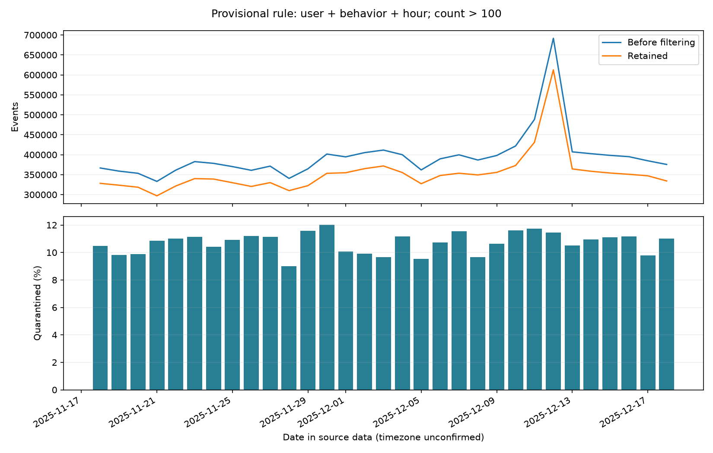

> 历史记录：其中跨商品筛查为当时的暂行规则，已于 2026-11-17 被带教确认的含商品分组替代。当前结果见 README 与 11/17 工作记录。

# 2026-11-16 工作记录：暂行数据版本与覆盖核验

对应第二周周一计划：跟进小时频次分组与阈值、行为码、时区和采样完整性，固定可追溯的数据版本。今日已完成技术核验和暂行快照；业务口径尚未冻结。用户反馈带教尚未回复，继续按暂行规则核验。

## 今日完成

1. 新增 `data_audit.py`，核验原始 CSV 指纹、时间覆盖、逐日筛查影响与 Parquet 记录及重复次数。
2. 从有效记录重新计算小时分组频次，与已保存 Parquet 做双向 `EXCEPT ALL` 比较，验证未丢失或新增正常重复记录。
3. 核验隔离文件行数和阈值边界；生成原始文件、规则、产物指纹共同标识的暂行快照。
4. 输出逐日对照 CSV、行为码分布及影响图；增加覆盖缺口、快照变化、来源变化和重复记录丢失测试。

## 实际核验结果

| 检查 | 结果与解释 |
|---|---|
| 原始数据指纹 | 与原清洗质量记录一致，原 CSV 未变化 |
| 时间范围 | 2025-11-18 00 至 2025-12-18 23 |
| 小时覆盖 | 31 天、744 个小时均有记录；无整小时空白 |
| 采集完整性 | 未确认；没有整小时空白不能证明漏采率为零 |
| 行为码值域 | 只观察到 1、2、3、4，语义仍以业务字典确认为准 |
| 当前分组 | 暂按用户＋行为＋自然小时，跨商品累计 |
| 阈值边界 | 大于 100 整组隔离；100 次及以下全部保留 |
| 原始 / 隔离 / 保留记录 | 12,256,906 / 1,316,083 / 10,940,823 |
| 每日隔离比例 | 8.99% - 12.02%，最高为 2025-11-30 |
| 活跃用户影响 | 20 天的 DAU 有变化，累计减少 37 个用户日；不是 37 名独立用户 |
| 购买用户影响 | 31 天的每日购买用户数均不变 |
| Parquet 记录验证 | 与重新计算规则的结果逐条一致，重复次数也一致 |

仅检验数据值域，不能由代码值推断业务语义；时间没有时区标记，保留原值，不擅自转换时区。31 天来自历史数据观察范围，与实习日期不同。

## 暂行版本记录

快照 ID：`provisional-5788bb303ec3967f`。

[快照清单](../../reports/audits/2026-11-16/data_snapshot.json) 记录原始 CSV、事件与隔离 Parquet 的 SHA256、规则参数、审核时间和待确认事项。该标识可用于复核产物版本，不代表带教审批或最终业务验收。改变分组、阈值、来源或事件文件后必须创建新快照并重跑下游。

[逐日影响表](../../reports/audits/2026-11-16/daily_filter_impact.csv) · [行为码分布](../../reports/audits/2026-11-16/observed_behavior_codes.csv)



上图比较筛查前有效事件与保留事件；下图展示每一天的隔离比例。图中差异来自暂行筛查，不是业务增长或下降。

## 尚待带教确认

- “超过 100 次”是否跨商品累计，超阈值是否整组排除主分析？包含商品维度时，本批最高为 22 次，不会隔离任何组。
- 行为码 1/2/3/4 是否对应浏览/收藏/加购/购买？
- 数据使用哪个业务时区？是否抽样，如何采集，首尾日期是否完整？

待确认项目保持 pending；不将原始文件未变化或技术测试通过等同于这些业务事项已获确认。

## 复现与验证

```bash
PYTHONPATH=src python -m douyin_analysis.data_audit --input ../user_behavior.csv --date 2026-11-16
python scripts/run_checks.py
```

本机命令使用仓库上级的 `.venv/bin/python`。标准新环境按 README 安装后运行。质量检查覆盖 src、tests、scripts，日志见 [quality_checks.txt](../../reports/quality_checks.txt)。

## 明日安排（11/17）

依据当前规则先完善窗口特征定义与边界测试，将数据快照 ID 写入实验记录。若带教仍未回复，特征产物标注暂行，保留重跑能力；不引用旧 LR 指标，不提前开展后续深度模型。收到口径变更后，优先重跑受影响的数据与报告。
