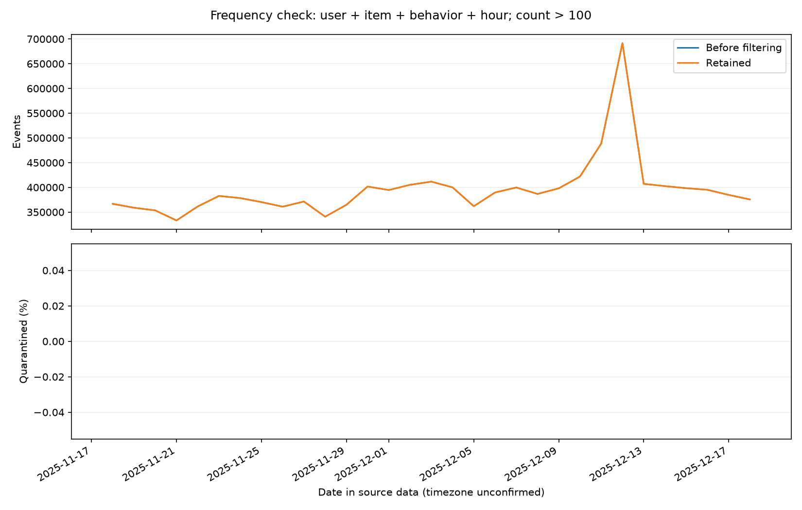

# 2026-11-17 清洗口径确认与全量重跑

## 确认依据

用户转述带教：“按2走，按你目前这个状态 应该就不用去重了，全部保留就行”。
口径②为 **同一用户、同一商品、同一行为、同一自然小时**，即 `user_item_behavior_hour`；阈值为严格超过 100 次。

本批最大频次 22，未触发阈值。全部有效记录保留，不合并正常重复交互，不作跨商品隔离。此确认不扩展为所有业务语义已确认。

## 当前结果

| 指标 | 结果 |
|---|---:|
| 原始记录 / 保留记录 | 12,256,906 / 12,256,906 |
| 无效 / 去重 / 隔离记录 | 0 / 0 / 0 |
| 用户 / 商品 / 类目 | 10,000 / 2,876,947 / 8,916 |
| 行为码 1 / 2 / 3 / 4 的记录数 | 11,550,581 / 242,556 / 343,564 / 120,205 |
| 最大用户商品行为小时频次 | 22 |
| 观察天数 / 有记录小时数 | 31 / 744 |
| 日事件峰值 | 2025-12-12，691,712 条 |
| 小时事件峰值 | 21 时 |

此前跨商品暂行隔离的 1,316,083 条已全部恢复。逐日事件数、活跃用户数和行为码 4 用户数均与有效原始数据一致。恢复后小时峰值为 21 时，应替代旧报告的 22 时结论。

## 产物与验证

- 全量重建 Parquet、用户/商品汇总、SQLite 和八张结果图；明细与数据库仅保留本地。
- 独立按确认分组重算，使用双向 `EXCEPT ALL` 比较事件 Parquet：记录及重复次数完全一致。隔离分区为 0 条。
- 来源 SHA256：`64c1436d3f984f813c12c730950d61cdc1892e8dbbb54e102911b182c2690072`，原始文件保持不变。
- 本次数据快照：`provisional-2cacdd7b8760d553`。前缀 `provisional` 表示行为码、时区与采样完整性尚未整体确认；分组确认状态已单独标为 `confirmed`。
- [数据快照与产物指纹](../../reports/audits/2026-11-17/data_snapshot.json)
- [逐日全量保留核验](../../reports/audits/2026-11-17/daily_filter_impact.csv)
- [跨格式一致性检查](../../reports/output_validation.json)；[当前编码规范与测试日志](../../reports/quality_checks.txt)。
- [第一周口径确认 PDF，含八张图](../../output/pdf/2026-11-17_第一周项目汇报_口径确认版.pdf)



## 历史与当前版本

11/13 的四元组去重及 11/15 的跨商品暂行筛查均不作为当前分析依据。旧报告和产物保留在历史目录，README 指向本次版本。旧模型结果仍标为失效，本次没有新增训练实验。

## 复现

在仓库根目录使用已安装项目依赖的 Python，依次执行：

```bash
python -m douyin_analysis.pipeline --input ../user_behavior.csv --threshold 100 --scope user_item_behavior_hour
python scripts/analyze_hourly_frequency.py
python -m douyin_analysis.sqlite_store
python -m douyin_analysis.plots
python -m douyin_analysis.reporting
python -m douyin_analysis.data_audit --input ../user_behavior.csv --date 2026-11-17 --scope-confirmed
python scripts/validate_outputs.py
python scripts/run_checks.py
python scripts/build_weekly_pdf.py
```

`--scope-confirmed` 只记录已收到的分组确认，不能用于自动证明业务正确性。未来数据若出现大于 100 次的组，程序可隔离保存，但最终处置仍须确认。

## 下一步

完善窗口特征字典、候选覆盖和标签边界；行为码、时区及采集完整性需继续确认。后续模型按实际进度开展，并在 11/20 周报中区分已完成与计划，不提前填报结果。

## 当日后续进展

收到继续推进要求后，已完成 24 项窗口特征与三个时间样本，新增 5 项边界核验；完整测试增至 26 项。结果与限制见[窗口特征与样本核验](../10_窗口特征与样本核验.md)。本记录前文描述的是先前清洗修订交付。
