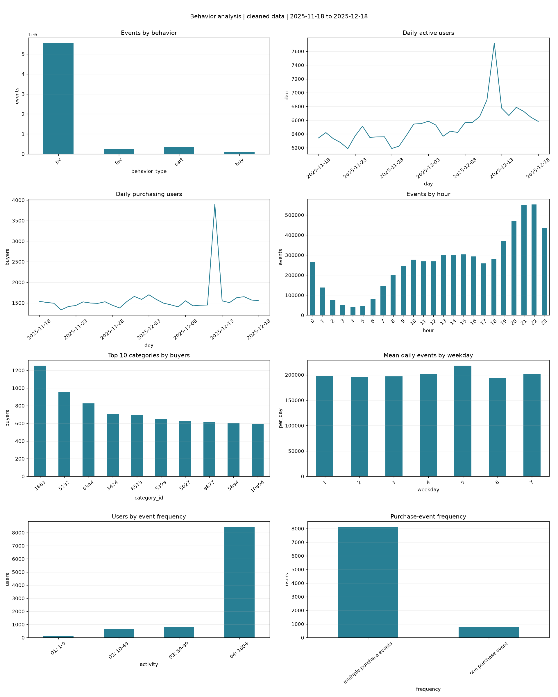

# 数据处理与探索分析报告

生成依据：本地全量 CSV 清洗后的实际运行产物。不是平台总体统计。

## 数据质量与规模

| 指标 | 结果 |
|---|---:|
| 原始记录 | 12,256,906 |
| 无效记录 | 0 |
| 四元组重复记录 | 6,043,527 |
| 清洗后记录 | 6,213,379 |
| 独立用户 | 10,000 |
| 独立商品 | 2,876,947 |
| 独立类目 | 8,916 |
| 多类目商品 | 0 |

数据范围：2025-11-18 00:00:00 至 2025-12-18 23:00:00。
来源 SHA256：`64c1436d3f984f813c12c730950d61cdc1892e8dbbb54e102911b182c2690072`。

口径：按用户、商品、行为、小时全局去重。小时内真实重复行为也可能被折叠。
折叠比例 49.31%，必须优先核实。
逐行为影响见 dedup_sensitivity.csv；键重复次数分布见 duplicate_multiplicity.csv。
未按 IQR 删除重度用户或活动日峰值。没有订单号和金额，购买事件不是订单/GMV。

## 主要发现与待验证建议

1. 清洗后购买行为 106,678 条，占事件 1.72%。
   这只是事件结构，不是购买用户率；后续模型须关注自然正例率及 PR-AUC。
2. 日事件峰值为 2025-12-12，共 346,464 条。
   建议进一步拆解用户、类目与重复行为贡献；不能仅凭日期推断促销造成增长。
3. 聚合事件峰值时段为 22 时。
   可作为运营时段研究起点，需再对比购买用户率和流量构成，不能直接认定最优投放。
4. 浏览过的用户商品对为 4,677,501；
   其中严格后续小时购买的对为 54,305，占 1.16%。
   首次浏览和最后购买同小时的对为 41,221，顺序不明。
   此指标受观察窗截尾影响，不是七日预测的标签转化率。

## 图表与追溯

八类图对应行为分布、DAU、日购买用户、小时分布、类目买家、
按星期的日均事件、用户交互强度、购买事件频次。
所有数值见 reports/*.csv，单图见 figures/。

## 限制与下一步

只有 1 万用户样本，采样机制未知；不能外推到百万用户全量。
没有内容侧、金额或曝光数据；无法完成真实 RFM、短视频归因或 CTR。
同小时顺序不可辨，标准化去重须做敏感性分析。
下一步：历史窗口特征、候选召回覆盖、七日标签与时间外推 LR；
扩展树模型和深度模型前先验证无数据泄漏。
