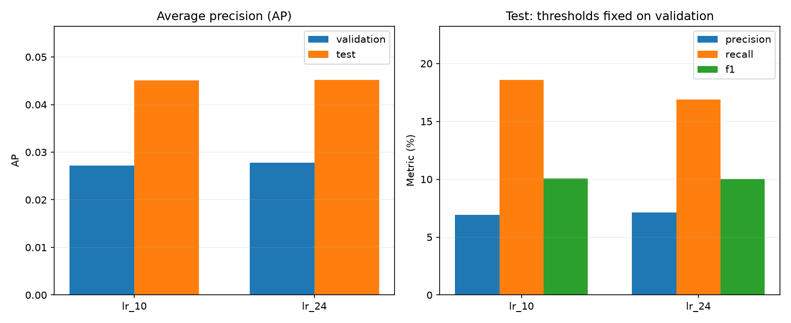
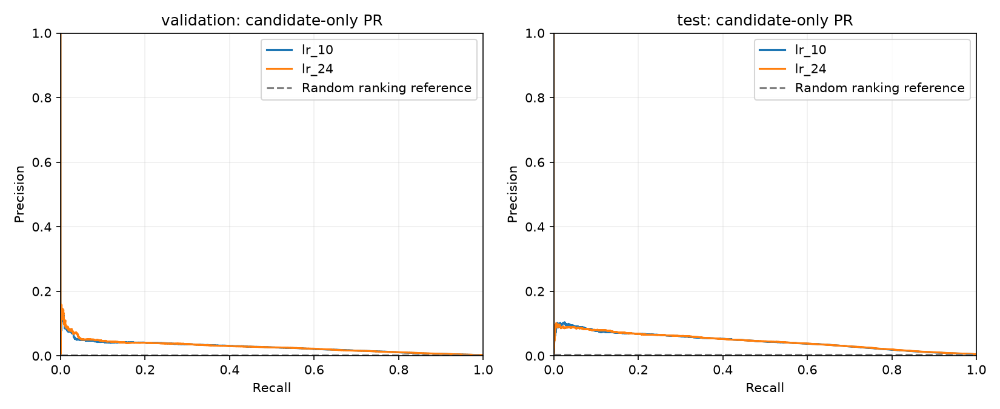

# LR 基线与窗口特征对照实验

执行：2026-11-17。数据为确认分组后的全量保留版本。
旧四元组去重实验已失效，本报告不使用旧模型指标作增益对照。

## 任务和适用边界

在历史七日交互过的用户商品候选中，预测未来七日是否观测到行为码 4。
行为码 4 暂按购买解释，行为语义、业务时区、采样与采集完整性仍待确认。
负标签仅表示未观测到该行为，不证明用户没有购买。结果是离线样本实验，非线上效果。
数据快照：`provisional-2cacdd7b8760d553`。
训练/验证/测试候选数分别为 1,030,893 / 1,061,515 / 1,117,324。
七日窗口及样本来源见[样本核验](../docs/10_窗口特征与样本核验.md)。

## 预先固定的实验方案

仅比较原 10 项与扩展 24 项特征，样本、类别权重和求解器一致。
计数与间隔使用 log1p；二元标记和比例保留原值；StandardScaler 只在训练集拟合。
LR：C=1、class_weight=balanced、lbfgs、max_iter=500、random_state=42。
没有重采样，没有网格调参。加权 LR 的输出用于排序和阈值判定，不视为校准购买概率。
方案按验证集 AP 选择；每个方案独立按验证集最大 F1 定阈值，并列取更高阈值。
验证决策写盘后才加载测试样本，同时评价两个预先指定的方案；不按测试结果换方案或阈值。
按验证集 AP 选择的方案：**lr_24**。
AP 使用 average_precision_score，非梯形积分 PR 曲线面积。

## 验证集结果

| 方案 | AP | ROC-AUC | Precision | Recall | F1 | 固定阈值 |
|---|---:|---:|---:|---:|---:|---:|
| lr_10 | 0.027179 | 0.880810 | 4.04% | 22.50% | 0.0685 | 0.93859987 |
| lr_24 | 0.027830 | 0.883743 | 4.08% | 20.04% | 0.0678 | 0.94867474 |

## 测试集结果

| 方案 | AP | ROC-AUC | Precision | 候选内 Recall | F1 | 全部未来对 Recall |
|---|---:|---:|---:|---:|---:|---:|---:|
| lr_10 | 0.045078 | 0.871989 | 6.92% | 18.59% | 0.1008 | 3.05% |
| lr_24 | 0.045193 | 0.875740 | 7.14% | 16.89% | 0.1004 | 2.77% |

全部未来对 Recall = 正确预测的购买对 / 该标签窗全部行为码 4 对（31,583）。
候选只覆盖其中 5,175 对，覆盖率 16.39%，其余 26,408 对未进入模型。
这个汇总指标仍基于给定样本，不是全平台购买召回率。

| 方案 | 预测正例 | 真正例 | 假正例 | 假负例（候选内） | 迭代次数 |
|---|---:|---:|---:|---:|---:|
| lr_10 | 13,907 | 962 | 12,945 | 4,213 | 21 |
| lr_24 | 12,244 | 874 | 11,370 | 4,301 | 48 |

## 解释与限制

24 项特征的测试 AP 绝对差仅 0.000114，Precision 略升，Recall 和 F1 下降。
因此不能声称新增特征带来明显或全面改善；保留按验证 AP 冻结的选择，不事后改用测试 F1 选优。
测试正例率约 0.4632%；全部预测为负也有约 99.54% Accuracy，不能仅以准确率判断好坏。
两组模型均正常收敛。训练耗时见指标 JSON，仅含特征变换和拟合，不含数据读取和评价。
目前只有一个时间外测试窗口，未做统计显著性检验；不同日期、抽样方式和业务定义下效果可能变化。
完整样本已用于本轮测试；后续不得依据这个测试集反复调参并宣称独立最终验证。
系数属于经变换、标准化后的相关性方向，不代表因果贡献；共线性影响系数解释。

## 结果图





## 验证与复现

数据和样本指纹均核对；合成样本验证训练集独立缩放、验证阈值冻结、并列处理及旧样本拒绝。
规范检查和 30 项测试通过。结果保存代码经拆分后同参数复跑，全部评价指标一致，未用测试结果调参。
模型与缩放器保存在本地 data/models/，不上传用户明细或模型二进制。

```bash
python -m douyin_analysis.lr_experiment
python -m douyin_analysis.experiment_report
python scripts/run_checks.py
```

旧命令 python -m douyin_analysis.modeling 已转入上述固定样本实验入口。
再次执行会覆盖该实验目录；参数方案变化时应使用新的实验标识保存，避免混用。

证据：[协议](experiments/lr_2026-11-17/protocol.json)、
[验证决策](experiments/lr_2026-11-17/validation_decision.json)、
[完整指标](experiments/lr_2026-11-17/metrics.json)、
[标准化系数](experiments/lr_2026-11-17/coefficients.csv)。

## 下一步

在固定样本上预先定义树模型对照，用训练和验证数据开展调参；同时研究候选覆盖不足。
多轮优化后的独立最终验证需另留未使用数据或补充数据，避免重复使用当前测试窗选优。
本轮尚未开展树模型、深度模型或线上 A/B 实验。
